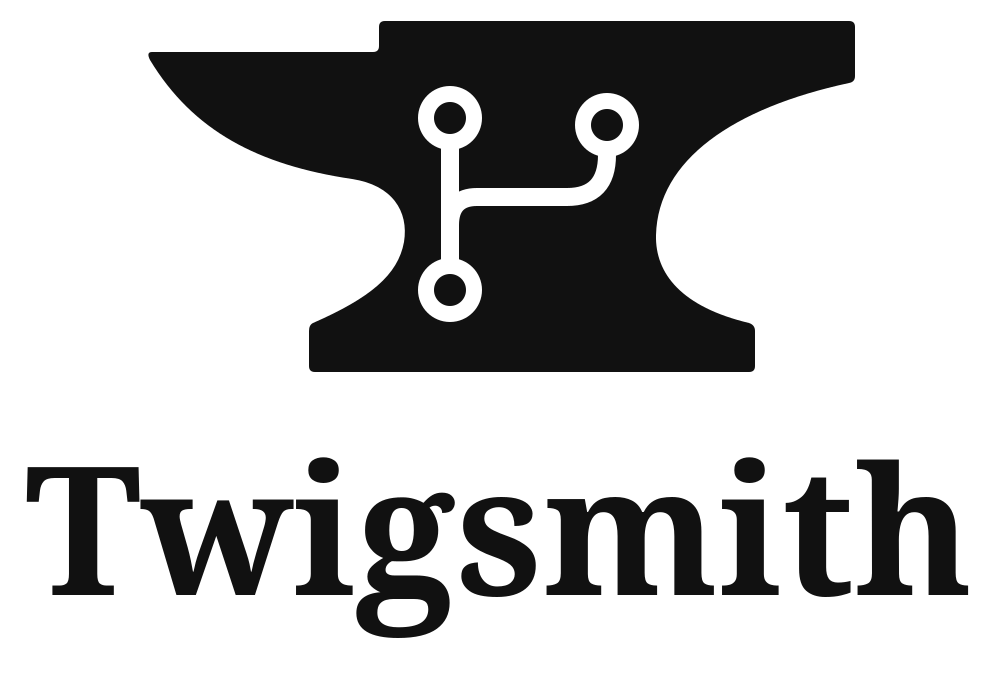

# Twigsmith

<picture>
  <source media="(prefers-color-scheme: dark)" srcset="https://raw.githubusercontent.com/msanguineti/twigsmith/main/site/assets/logo-dark.svg">
  
</picture>

A Git workflow CLI for starting workstreams, saving progress, and delivering
finished work, releases, and hotfixes. Invoke it as `twigsmith` or the equivalent
shorthand `tgi`; both share settings and recovery state.

Twigsmith targets Linux x86_64 with glibc 2.35 or newer and requires Git 2.45 or
newer. It provides `start`, `save`, `finish`, `status`, `config`, and `completion`.
Choose a published version from the [npm package page](https://www.npmjs.com/package/twigsmith),
then replace `VERSION` with that version to install it:

```sh
npm install --global twigsmith@VERSION
tgi --version
```

To run it without a global installation:

```sh
npx --yes --package=twigsmith@VERSION tgi --help
```

For npm/npx, use Node.js LTS and npm. Native execution needs neither. Native archives and their checksums are available from
[GitHub releases](https://github.com/msanguineti/twigsmith/releases).
See the [user guide](https://github.com/msanguineti/twigsmith/blob/main/docs/USAGE.md#native-archive-candidates) for verification and
runtime prerequisites, or build from source using the [development guide](https://github.com/msanguineti/twigsmith/blob/main/docs/DEVELOPMENT.md).

## Quick start

Once a built executable is on PATH, run these commands from your Git checkout:

```sh
tgi start add-user-avatars
# Work and make normal Git commits
tgi save
tgi finish
tgi status
```

`start` creates or resumes a branch; `save` preserves and publishes progress.
`finish` prepares work, runs configured checks, and either publishes the branch for
manual review or integrates it into the configured target. It creates no pull
request and performs no deployment. `status` summarizes the current checkout.

| Command | Shorthand | Purpose |
| --- | --- | --- |
| `start <branch-name>` | `s` | Create or resume a workstream |
| `save [options]` | `v` | Preserve progress and publish the branch |
| `finish [options]` | `f` | Deliver finished work for review or integration |
| `status` | | Inspect repository state |
| `config` / `config show` / `config --yes` | | Set up or inspect shared settings |

Run `tgi config` to choose a publication remote and a base source for a single
repository or a fork. Use `tgi config show` to inspect effective roles and sources.
See the [user guide](https://github.com/msanguineti/twigsmith/blob/main/docs/USAGE.md#remote-roles-and-fork-workflows) for both
workflows and tracking styles.

For releases and hotfixes, select explicit policy with an editable
[direct OneFlow](https://github.com/msanguineti/twigsmith/blob/main/docs/USAGE.md#direct-releases-and-hotfixes)
or [hosted OneFlow](https://github.com/msanguineti/twigsmith/blob/main/docs/USAGE.md#hosted-releases-and-hotfixes)
setup. Branch prefixes alone select no policy. The user guide also covers
[interactive history editing](https://github.com/msanguineti/twigsmith/blob/main/docs/USAGE.md#edit-ordinary-work-history).

Terminal menus support arrow keys and Enter; slow Git operations show activity.
`NO_COLOR` disables colour, and redirected output stays plain. See the
[user manual](https://github.com/msanguineti/twigsmith/blob/main/docs/USAGE.md#start-or-resume-work) for command details.

Use `tgi --help` or `tgi <command> --help` for a quick reference.
Enable Tab completion for Bash, Zsh, Fish or PowerShell with the
[shell completion guide](https://github.com/msanguineti/twigsmith/blob/main/docs/USAGE.md#shell-completion).

## Documentation

- [User manual](https://github.com/msanguineti/twigsmith/blob/main/docs/USAGE.md): commands, settings, automation, and recovery.
- [Contributor guide](https://github.com/msanguineti/twigsmith/blob/main/docs/DEVELOPMENT.md): setup, builds, checks, and
  troubleshooting.
- [Technical manual](https://github.com/msanguineti/twigsmith/blob/main/docs/ENGINEERING.md): architecture, workflow invariants,
  failure handling, and implementation diagnosis.

Licensed under [MIT](https://github.com/msanguineti/twigsmith/blob/main/LICENSE).
